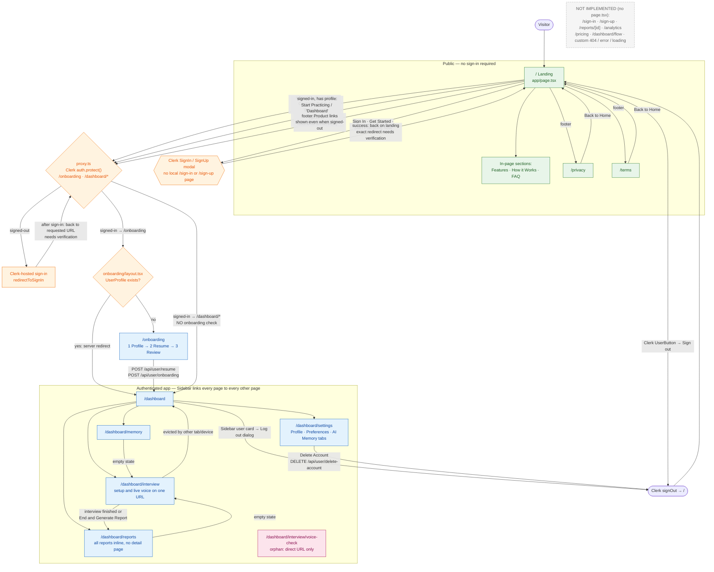
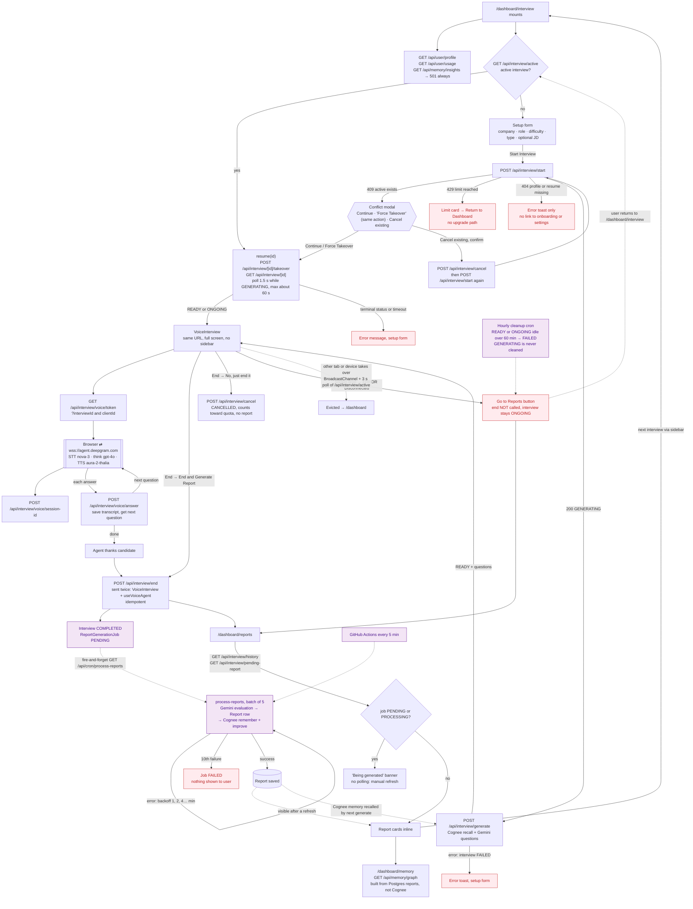
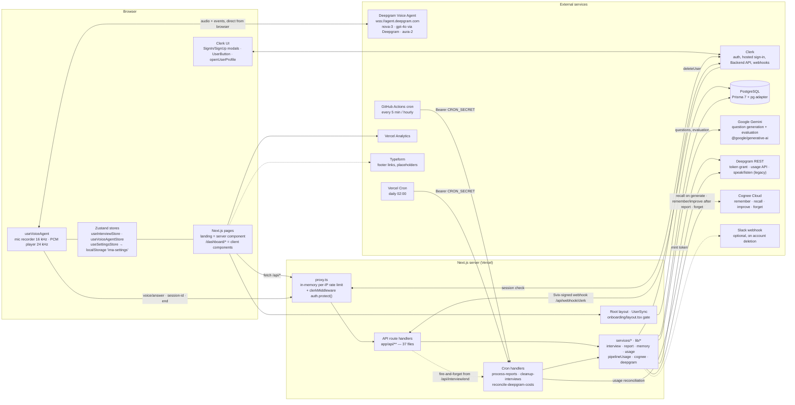

# Clutchly — Frontend Routes & Access Architecture Audit

> **Status update (2026-10-09, routing refactor):** this audit describes the code *before* the routing refactor. Since then:
>
> - `/dashboard/*` moved to `/interviews`, `/interviews/new`, `/interviews/check`, `/interviews/[id]/live`, `/reports`, `/reports/[id]`, `/memory`, `/analytics` and `/profile`. Legacy URLs now 307-redirect (`next.config.ts`).
> - A server-side onboarding gate (`app/(app)/layout.tsx`) now covers every product route (N1/E2).
> - S1 (`/api/reports/[id]`), S2 (`/api/interview/end`) and the `interviewId` part of S6 (`/api/interview/voice/token`) now enforce ownership.
>
> Findings not listed here are unchanged.

| | |
|---|---|
| **Audit date** | 2026-10-09 |
| **Repository state** | branch `main`, commit `416e96c` (working tree clean at start) |
| **Framework versions (from `node_modules`)** | Next.js 16.2.9 (App Router, `proxy.ts` = the Next 16 name for middleware), `@clerk/nextjs` 7.5.12, Prisma 7.8, React 19.2.4 |
| **Method** | Read-only static inspection of source code. The app was **not** run, no endpoint was called, no database was touched. Environment variable **names** were checked in `.env.local`; values were not read or recorded. |
| **Deliverable scope** | Every `page.tsx`, `layout.tsx`, `route.ts`, `proxy.ts`, navigation component, hook, store and service that participates in routing, access control or the interview lifecycle. |

**Confidence labels used throughout**

- **Confirmed** — directly visible in source; file and line cited.
- **Likely** — strongly implied by source, but depends on runtime behaviour that was not executed.
- **Needs manual verification** — depends on deployment configuration (Clerk dashboard, Vercel env vars, GitHub secrets) or third-party runtime behaviour that cannot be verified statically.

---

## Table of contents

1. [Executive summary](#1-executive-summary)
2. [Route / page / API counts and counting rules](#2-route--page--api-counts-and-counting-rules)
3. [Complete frontend route inventory](#3-complete-frontend-route-inventory)
4. [Access matrix — public vs authenticated vs owner-only](#4-access-matrix--public-vs-authenticated-vs-owner-only)
5. [API endpoint inventory](#5-api-endpoint-inventory)
6. [Diagram A — Application access and navigation](#6-diagram-a--application-access-and-navigation)
7. [Diagram B — Interview lifecycle](#7-diagram-b--interview-lifecycle)
8. [Diagram C — High-level technical architecture](#8-diagram-c--high-level-technical-architecture)
9. [Ten user journey walkthroughs](#9-ten-user-journey-walkthroughs)
10. [Existing navigation inventory](#10-existing-navigation-inventory)
11. [Gaps, risks and findings](#11-gaps-risks-and-findings)
12. [Documentation mismatches](#12-documentation-mismatches)
13. [Questions requiring product-owner decisions](#13-questions-requiring-product-owner-decisions)

---

## 1. Executive summary

**What exists.** Clutchly's frontend is small: **10 frontend pages, all static URLs, no dynamic pages, no route groups, no custom 404/error/loading boundaries.** It splits into three public pages (`/`, `/privacy`, `/terms`), one onboarding page (`/onboarding`) and six pages under `/dashboard`. Sign-in and sign-up have **no local pages**: they happen in Clerk modals or on Clerk's hosted sign-in page. Behind the UI sit **37 API route files** with **39 method handlers**.

**How access works.** One file, `proxy.ts`, protects `/onboarding`, `/dashboard(.*)` and most `/api/*` prefixes with Clerk `auth.protect()`. All six dashboard pages are client components. They have no server-side guard of their own and no dashboard `layout.tsx`. Their data comes from API routes, and most of those check the Clerk session again and scope queries to the signed-in user. The only server-side "state gate" is in `app/onboarding/layout.tsx`: it sends users who already have a profile to `/dashboard`. **The opposite direction has no gate.** A signed-in user who never finished onboarding can open every `/dashboard/*` page, and only finds out when "Start Interview" fails.

**Most important findings**

| # | Finding | Class |
|---|---|---|
| S1 | `GET /api/reports/[id]` returns **any** user's report to any signed-in user (no ownership check). | Confirmed — High |
| S2 | `POST /api/interview/end` does not check that the caller owns `interviewId`. It can return another user's report, force-complete another user's live interview, and attach a report job to the wrong owner, so the victim's report is never generated. | Confirmed — High |
| S3 | Cron endpoints sit outside the Clerk matcher and **fail open** when `CRON_SECRET` is unset. | Confirmed in code; prod env needs verification |
| S4 | `GET /api/cognee/health` is public and writes a test memory to the shared Cognee dataset on every call. | Confirmed — Medium/Low |
| S5 | The rate limiter is in-memory and per-instance, so it gives little protection on serverless. | Confirmed — Medium |
| N1 | No onboarding gate on `/dashboard/*`, and no in-app link back to `/onboarding`. | Confirmed |
| N2 | The "Dashboard" buttons on public pages actually open `/dashboard/interview`. | Confirmed |
| I1 | Reports have no detail page. The reports list never shows per-question feedback or historical progress: the data isn't stored, so those UI sections can never render. | Confirmed |
| I2 | Dashboard and interview pages call `/api/memory/insights`, which always returns `501`. | Confirmed |
| I3 | Failed report jobs disappear silently. The "being generated" banner never refreshes on its own. | Confirmed |
| M1 | Several numbers are misleading: weekly goal uses the all-time count, "+X% this week" is really the difference between the last two interviews, the memory "Relationship Map" is decorative, and "Reset Memory" seems to work but the facts come back after reload. | Confirmed |
| D1 | Documentation (`docs/FRONTEND_WORKFLOW.md`, `README.md`, `docs/API_REFERENCE.md`) describes routes, methods and models that do not match the code. | Confirmed |

---

## 2. Route / page / API counts and counting rules

### Counting rules

- A **frontend page** is a `page.tsx` under `app/`. Its URL is computed by App Router rules: folders become segments, `(group)` folders would be dropped, `[param]` becomes dynamic. Layouts, components and API routes are **not** pages.
- A **static route** has no dynamic segment. A **dynamic route pattern** has one or more `[param]`, `[...param]` or `[[...param]]` segments.
- A **redirect-only route** is a page or config entry whose only behaviour is to redirect. Pages that render content but *conditionally* redirect are counted as normal pages and flagged separately.
- **Authentication and onboarding routes** are URLs whose purpose is sign-in, sign-up or onboarding.
- An **API endpoint** is a `route.ts` under `app/api/`. Both *files* (URL patterns) and *method handlers* (GET/POST/…) are counted.
- **Special routes** are `loading.tsx`, `error.tsx`, `global-error.tsx`, `not-found.tsx`, `default.tsx`, `template.tsx` and file-based metadata routes such as `favicon.ico`.

### Counts

| Category | Count | Detail |
|---|---|---|
| 1. Unique frontend URL patterns | **10** | `/`, `/privacy`, `/terms`, `/onboarding`, `/dashboard`, `/dashboard/interview`, `/dashboard/interview/voice-check`, `/dashboard/reports`, `/dashboard/memory`, `/dashboard/settings` |
| 2. Static frontend routes | **10** | All of the above |
| 3. Dynamic frontend route patterns | **0** | No `[param]` folders exist under `app/` outside `app/api/` |
| 4. Redirect-only routes | **0** | No redirect-only page, and no `redirects()` in `next.config.ts`. One page redirects *conditionally*: `/onboarding` → `/dashboard` when a profile exists (`app/onboarding/layout.tsx:15-24`). |
| 5. Authentication and onboarding routes | **1 local** (`/onboarding`) | **0 local sign-in/sign-up pages.** `proxy.ts:24-25` marks `/sign-in(.*)` and `/sign-up(.*)` public, but no page exists at either path. Sign-in/up is done with Clerk modals (`SignInButton`/`SignUpButton mode="modal"`) or Clerk's hosted sign-in page (reached via `auth.protect()` → `redirectToSignIn`). |
| 6. API endpoints | **37 route files / 39 method handlers** | 34 static + **3 dynamic** API patterns (`/api/interview/[id]`, `/api/interview/[id]/takeover`, `/api/reports/[id]`). `GET`+`PATCH` on `/api/user/profile` and `GET`+`POST` on `/api/memory/timeline` account for the extra handlers. |
| 7. Special routes | **0 custom boundaries** | No `loading.tsx`, `error.tsx`, `global-error.tsx`, `not-found.tsx`, `default.tsx` or `template.tsx` anywhere. There is one file-based metadata route (`app/favicon.ico` → `/favicon.ico`), plus Next's built-in default 404. |
| Layouts (not pages) | 2 | `app/layout.tsx` (root), `app/onboarding/layout.tsx` |
| Route groups / parallel / intercepting routes | 0 | None |
| Routing conflicts | **None found** | No two files resolve to the same URL. (Side note: `/api/interview/voice` has no `route.ts`, so a request to it falls through to `/api/interview/[id]` with `id="voice"` and returns 404. Harmless.) |

### Routes that exist vs routes that are linked

| Route | Exists | Linked from UI |
|---|---|---|
| `/` | Yes | Yes (sidebar logo, header logo, onboarding "Home", privacy/terms "Back to Home") |
| `/privacy`, `/terms` | Yes | Yes (footers) |
| `/onboarding` | Yes | **Only from landing-page CTAs** shown to signed-in users without a profile. Not linked from any `/dashboard` page. |
| `/dashboard` | Yes | Yes (sidebar, footers, interview "Back") |
| `/dashboard/interview` | Yes | Yes (sidebar "Interviews", many CTAs) |
| `/dashboard/interview/voice-check` | Yes | **No — direct URL only** |
| `/dashboard/reports`, `/dashboard/memory`, `/dashboard/settings` | Yes | Yes (sidebar, footers, dashboard cards) |
| `/dashboard/flow` | **No** | Defined in `ROUTES.flow` (`lib/utils/constants.ts:30`) but never used |
| `/sign-in`, `/sign-up` | **No** | Listed as public in `proxy.ts:24-25`; no UI links |
| `/reports/[id]`, `/analytics`, `/memory`, `/settings`, `/interview/setup`, `/interview/live`, `/interview/processing` | **No** | Documented in `docs/FRONTEND_WORKFLOW.md`; not implemented |
| `/#pricing` | Section exists in code but is commented out | Links commented out (`Navbar.tsx:35-40`, `Header.tsx:33-38`) |

---

## 3. Complete frontend route inventory

> All six `/dashboard/*` pages are `"use client"` components. They load data through `fetch()` calls to API routes after mount. None of them reads the database directly.

| Route | Source file | Page name | Purpose | Access | Data | Entry points | Exit / next steps | Status |
|---|---|---|---|---|---|---|---|---|
| `/` | `app/page.tsx` (server component) + `components/landing-page/*` | Landing page | Marketing page: hero, core features, how-it-works, FAQ, footer. Social proof and Pricing sections are commented out (`app/page.tsx:33,39-40`). | **Public.** Personalises CTAs for signed-in users. | Static marketing copy + session (`auth()` clerkId) + DB (checks whether a `UserProfile` exists → `setupDone`, `app/page.tsx:15-27`). Hero image is static `/Demo.png`. | Direct URL; logo links (sidebar, header); "Back to Home"; onboarding "Home"; post-logout redirect; post-account-deletion redirect. | Signed-out: Clerk modals (Sign In / Get Started / Start Practicing Now / Start Your First Interview), anchors `#features` `#how-it-works` `#faq`, `/privacy`, `/terms`, footer product links (bounce to sign-in). Signed-in: "Dashboard"/"Start Practicing" → `/dashboard/interview` (if profile) or `/onboarding` (if no profile); Clerk `UserButton`. | **Working** |
| `/privacy` | `app/privacy/page.tsx` | Privacy Policy | Legal text. | **Public** | Static | Footer "Privacy Policy" (landing footer, shared footer, onboarding minimal footer) | `components/Header.tsx` nav (anchors to `/#…`, Sign In/Get Started modals, or "Dashboard" → `/dashboard/interview`), "← Back to Home", footer | **Working** (content partly inaccurate — see §12) |
| `/terms` | `app/terms/page.tsx` | Terms of Service | Legal text. | **Public** | Static | Footer "Terms of Service" | Same as `/privacy` | **Working** (describes Stripe billing that doesn't exist — §12) |
| `/onboarding` | `app/onboarding/page.tsx` (client) + `app/onboarding/layout.tsx` (server) | Onboarding wizard | 3 steps: **1 Profile** (name, experience, target role, GitHub, LinkedIn), **2 Resume** (PDF ≤10 MB), **3 Review**. "Complete" uploads the resume and saves the profile. | **Authenticated** (proxy) + **Conditional**: the layout redirects to `/dashboard` if a `UserProfile` row exists. | Session + DB writes: `POST /api/user/resume`, `POST /api/user/onboarding`. The Name field is collected but **not sent** (`page.tsx:197-209`). | Landing CTAs when signed in without a profile: Navbar "Dashboard", Hero "Continue Setup", How-it-works "Continue Setup". No link from inside the app. | On success → `/dashboard` after 800 ms (`page.tsx:225-227`). "Home" → `/`. Footer → `/privacy`, `/terms`. | **Working** |
| `/dashboard` | `app/dashboard/page.tsx` | Dashboard (home) | Greeting, interview count, quick actions (Start/Resume Interview, Update Profile, View Reports), 4 score tiles, AI Memory card, progress bars, recent interviews table, weekly goal ring, target-profile widget, floating "+" button. | **Authenticated** (proxy). **No onboarding gate.** | DB-backed via `GET /api/user/profile`, `/api/analytics`, `/api/interview/history`, `/api/memory/insights` (**always 501**), `/api/interview/active`. Weekly goal from `localStorage` (`useSettingsStore`). Name from Clerk `useUser()`. | Sidebar "Dashboard", footer "Dashboard", onboarding completion, `/onboarding` server redirect, interview "Back" / "Return to Dashboard", live-interview eviction. | `/dashboard/interview` (Start/Resume, FAB, empty-state CTA), `/dashboard/settings` ("Update Profile"), `/dashboard/reports` ("View Reports", "Full Report"), `/dashboard/memory` ("View All"). Recent-interview rows are **not clickable**. | **Working**, with misleading metrics (§11-M) |
| `/dashboard/interview` | `app/dashboard/interview/page.tsx` + `components/interview/VoiceInterview.tsx` + `hooks/useInterview.ts` + `hooks/useVoiceAgent.ts` | Interview setup **and** live voice interview (one URL) | **States on one URL:** (a) "Loading setup…" / "Resuming your interview…" recovery; (b) setup form (company, role, difficulty, optional job description, interview type); (c) "Generating Tailored Questions…"; (d) "Interview Limit Reached"; (e) conflict modal (an interview is already running); (f) **live voice interview** (full-screen `VoiceInterview`, no sidebar). | **Authenticated** (proxy) + **Conditional** to *start* an interview: needs a `UserProfile`, at least one `Resume`, usage under the limit (10/month, `lib/config/limits.ts:11-12`) and no other active interview. All enforced server-side in `/api/interview/start`. | DB + external: profile, usage, active-interview check, start/generate (Gemini + Cognee recall), Deepgram token + browser WebSocket to Deepgram Voice Agent, voice answers. `targetRole` mirrored in `localStorage`. | Sidebar "Interviews", footer "New Interview", landing CTAs (signed-in with profile), dashboard Start/Resume/FAB/empty-state, reports & memory empty-state CTAs. | Setup "Back" → `/dashboard`; finishing or "End & Generate Report" → `/dashboard/reports`; "No, just end it" → setup form; voice error → "Go to Reports"; eviction by another tab/device → `/dashboard`; limit reached → "Return to Dashboard". | **Working** (several confusing behaviours — §11) |
| `/dashboard/interview/voice-check` | `app/dashboard/interview/voice-check/page.tsx` + `components/interview/DeepgramStatus.tsx` + `hooks/useDeepgram.ts` | Voice connection check | Developer diagnostic ("Phase 3 – Step 1 verification page", file header): mints a Deepgram token, asks for microphone permission, opens a WebSocket. | **Authenticated** (proxy matches `/dashboard(.*)`). | External: `GET /api/speech/token` → Deepgram. | **None** — direct URL only. | None — no sidebar, no back link. | **Legacy / dev-only** |
| `/dashboard/reports` | `app/dashboard/reports/page.tsx` | Reports | Pending-report banner, then **every** report rendered inline: overall score, 5 sub-scores, per-question feedback (never renders), strengths/weaknesses, topics to review, recommendations, historical progress (never renders). | **Authenticated** (proxy). Data is owner-scoped by the session in the APIs. | DB: `GET /api/interview/history`, `GET /api/interview/pending-report`. Loaded **once** — no polling. | Sidebar "Reports", footer "Reports", dashboard "View Reports"/"Full Report", interview completion, voice error "Go to Reports", REPORT_READY "View Report". | Empty state → `/dashboard/interview`. Otherwise sidebar only. No per-report link or "start next interview" button. | **Working** / **Incomplete** (no detail view, dead sections) |
| `/dashboard/memory` | `app/dashboard/memory/page.tsx` + `lib/utils/memoryInsights.ts` | AI Memory | Profile summary, 5 category scores with deltas, recent sessions, decorative "Relationship Map", confidence journey, patterns, AI insight sentence, company readiness, "Structured AI Memory" facts, right-hand sidebar (≥ xl only: weekly goal, key improvements, memory status). | **Authenticated** (proxy); owner-scoped APIs. | DB: `GET /api/memory/graph` (**built from Postgres `Report` rows, not Cognee**), `/api/user/profile`, `/api/interview/history`. Weekly goal from `localStorage`. | Sidebar "Memory", footer "AI Memory", dashboard "View All". | Empty state → `/dashboard/interview`. Otherwise sidebar only. | **Working** (several sections decorative or mislabelled — §11-M) |
| `/dashboard/settings` | `app/dashboard/settings/page.tsx` | Settings | In-page tabs (no URL change): **Profile** (Clerk profile modal, experience, GitHub, LinkedIn, resume re-upload), **Preferences** (target role, weekly goal, difficulty, one target company, one interview type), **AI Memory** (two toggles that do nothing on the server, "Reset Memory"). Always-visible "Account Usage" with "Delete Account". | **Authenticated** (proxy); owner-scoped APIs. | DB + Clerk + Cognee + `localStorage`: `GET/PATCH /api/user/profile`, `POST /api/user/resume`, `GET /api/interview/history`, `GET /api/memory/graph`, `DELETE /api/cognee/forget`, `DELETE /api/user/delete-account`. | Sidebar "Settings", footer "Settings", dashboard "Update Profile". | Delete Account → Clerk `signOut({redirectUrl:"/"})` → `/`. Otherwise sidebar only. | **Working**; toggles and weekly goal are client-only (§11-I) |

### Non-existent URLs that the code or docs reference

| URL | Where referenced | Actual behaviour |
|---|---|---|
| `/sign-in`, `/sign-up` | `proxy.ts:24-25` (public matcher) | Next default 404 |
| `/dashboard/flow` | `lib/utils/constants.ts:30` (`ROUTES.flow`) | Unused constant. Visiting it: proxy requires auth, then 404. |
| `/reports/:id`, `/memory`, `/analytics`, `/settings`, `/reports`, `/interview/setup`, `/interview/live`, `/interview/processing` | `docs/FRONTEND_WORKFLOW.md` | 404 |
| `/#pricing` | Commented-out links | Section not rendered |

---

## 4. Access matrix — public vs authenticated vs owner-only

### How protection actually works (verified)

1. **`proxy.ts`** (Next 16 "Proxy", formerly middleware) runs for every non-static path (`proxy.ts:118-124`).
   - It applies **per-IP rate limiting to `/api/*`** first (`proxy.ts:61-90`). Webhooks and `OPTIONS` are excluded.
   - It then runs Clerk `auth.protect()` when the path matches `isProtectedRoute` and not `isPublicRoute` (`proxy.ts:7-32`).
   - **Protected list:** `/onboarding`, `/dashboard(.*)`, `/api/auth/me`, `/api/user(.*)`, `/api/interview(.*)`, `/api/reports(.*)`, `/api/memory(.*)`, `/api/analytics`, `/api/speech(.*)`.
   - **Not in the protected list (handler must protect itself):** `/api/cognee/*`, `/api/cron/*`, `/api/health`, `/api/webhook/clerk`. All public pages also fall outside the list.
2. **Clerk `auth.protect()` behaviour** (`node_modules/@clerk/nextjs/dist/esm/server/protect.js:17-23`):
   - signed-out **page/document request** → `redirectToSignIn()` (Clerk-hosted sign-in, since no local sign-in page exists);
   - signed-out **API/fetch request** → **404** response from the proxy (not 401);
   - server-action request → 401.
3. **Server layouts:** only `app/onboarding/layout.tsx` contains logic (sync user, redirect to `/dashboard` if a profile exists). **No `app/dashboard/layout.tsx` exists.**
4. **Root layout** (`app/layout.tsx:80-85`) renders `<UserSync />` on every request. It upserts the signed-in Clerk user into Postgres, matching by `clerkId` **or** email (`lib/auth/sync-user.ts:71-85`).
5. **API handlers** mostly call `auth()`, `currentUser()` or `requireUserId()` again, then scope queries by the internal `userId`. Exceptions are listed in §5 and §11.
6. **Client-side checks** exist only for rendering (`setupDone` CTAs, Clerk `<Show>`). None of them are relied on for security.

### Frontend route access matrix

| Route | Category | Signed-out visitor can open? | What happens signed-out | What happens signed-in | Redirects | Ownership check | Where enforced | Reachable by direct URL? |
|---|---|---|---|---|---|---|---|---|
| `/` | Public | Yes | Landing with Sign In / Get Started modals | Landing with "Dashboard"/"Start Practicing" (profile) or "Continue Setup" (no profile). **Not redirected** into the app. | None | N/A | Server component reads `auth()` | Yes |
| `/privacy` | Public | Yes | Policy page | Policy page | None | N/A | None needed | Yes |
| `/terms` | Public | Yes | Terms page | Terms page | None | N/A | None needed | Yes |
| `/onboarding` | Authenticated + Conditional | No | Proxy → Clerk-hosted sign-in (return URL: needs manual verification) | No profile → wizard. Has profile → **server redirect to `/dashboard`**. | Yes (layout) | N/A (user's own profile) | Proxy + server layout + API (`/api/user/onboarding` resolves the user from the session) | Yes |
| `/dashboard` | Authenticated | No | Proxy → Clerk sign-in | Dashboard renders, **even without onboarding**. An empty profile shows default "Software Engineer". | None | Data APIs scope by session user (`userId` query params are ignored server-side) | Proxy + each API | Yes |
| `/dashboard/interview` | Authenticated + Conditional (to start) | No | Proxy → Clerk sign-in | Setup form, or auto-resume of an active interview. Start fails with a toast if there is no profile (`Profile not found`), no resume (`Parsed resume not found`), the limit is reached (limit card), or another interview is active (conflict modal). | No route redirects. Eviction pushes to `/dashboard`. | Interview APIs `[id]`, `takeover`, `generate`, `cancel`, `voice/answer`, `voice/session-id` enforce ownership. **`/api/interview/end` does not (S2). `voice/token` only partially (S3).** | Proxy + API | Yes |
| `/dashboard/interview/voice-check` | Authenticated | No | Proxy → Clerk sign-in | Diagnostic page; can mint Deepgram tokens | None | N/A | Proxy + `/api/speech/token` handler | **Only** by direct URL |
| `/dashboard/reports` | Authenticated | No | Proxy → Clerk sign-in | Own reports only (list endpoint scoped by session) | None | Yes (`listReports(user.id)`) | Proxy + API | Yes |
| `/dashboard/memory` | Authenticated | No | Proxy → Clerk sign-in | Own memory facts (from own reports) | None | Yes (`report.interview.user.clerkId`) | Proxy + API | Yes |
| `/dashboard/settings` | Authenticated | No | Proxy → Clerk sign-in | Own profile; destructive actions for own account | None | Yes. `cognee/forget` compares the body `userId` to the session user. `delete-account` uses the session only. | Proxy + API | Yes |

**Owner-only frontend pages:** none. There are no resource-specific frontend URLs. Owner-only logic exists only in the API layer, and that is where the gaps are (§5, §11-S).

**Public pages that touch user-specific data:** only `/`, which reads whether a profile exists for the current session in order to pick CTAs. It shows no other user data. No other public page shows user data. *No flag.*

### Onboarding gate — verified behaviour

| Condition | `/` | `/onboarding` | `/dashboard/*` | `POST /api/interview/start` |
|---|---|---|---|---|
| Signed-out | Landing | → sign-in | → sign-in | 404 from proxy |
| Signed-in, **no** `UserProfile` | "Continue Setup" CTAs | Wizard | **Renders normally** (no gate) | `404 Profile not found` → toast |
| Signed-in, profile but **no** `Resume` (possible if a profile is created by `getOrCreateDBUser` or by `PATCH /api/user/profile`'s upsert) | "Start Practicing" CTAs | → `/dashboard` (cannot return to the wizard) | Renders | `404 Parsed resume not found` → toast. The fix is to upload a resume in Settings; the UI gives no guidance. |
| Signed-in, profile + resume | "Start Practicing" CTAs | → `/dashboard` | Renders | Proceeds (subject to limit / single-active rules) |

---

## 5. API endpoint inventory

**Legend.** *Proxy* = protected by `proxy.ts` Clerk matcher. *Handler* = handler checks auth itself. *Owner* = query is scoped to the authenticated user. *Used by UI* names the page/hook that calls it. Rate-limit rules live in `lib/rate-limit/config.ts` (in-memory, per IP, per instance).

Response envelopes are inconsistent: some routes return `{ ok, data|error }` (`ok()`/`fail()` helpers), others `{ success, data|message|error }` (`lib/utils/api.ts:6-47`).

### 5.1 Health / operations

| Method & URL | Source | Purpose | Auth | Owner | Request → Response | Dependencies | Used by UI | Concerns |
|---|---|---|---|---|---|---|---|---|
| `GET /api/health` | `app/api/health/route.ts` | DB liveness | **None** (public) | N/A | — → `{status, database, timestamp}` | Prisma `SELECT 1` | No (ops) | Fine for a liveness probe |
| `GET /api/cognee/health` | `app/api/cognee/health/route.ts` | Cognee smoke test | **None** (public, not in proxy list) | N/A | — → `{success}` / 502 / 503 | Cognee `healthCheck`, `remember`, `recall` | No (ops) | **Writes a test memory to the shared default Cognee dataset on every call** (`route.ts:16`; `services/cognee.service.ts:140`). Unauthenticated cost/abuse vector (S4). |

### 5.2 Authentication & user identity

| Method & URL | Source | Purpose | Auth | Owner | Request → Response | Dependencies | Used by UI | Concerns |
|---|---|---|---|---|---|---|---|---|
| `GET /api/auth/me` | `app/api/auth/me/route.ts` | Upsert current user; return user + profile + analytics | Proxy + Handler (`currentUser`) | Self | — → `{success, data:{user, profile, analytics}}` | Clerk, Prisma | **No** (only `hooks/useAuth.ts`, which nothing imports) | Creates an **empty `UserProfile`** if missing (`route.ts:22-46`). If called before onboarding, this satisfies the "profile exists" check and **permanently bypasses the onboarding wizard** (latent, S9). |
| `POST /api/webhook/clerk` | `app/api/webhook/clerk/route.ts` | Sync Clerk `user.created/updated/deleted` | Public; **Svix signature** via `verifyWebhook` | N/A | Clerk event → `{ok}` / 400 | Clerk, Prisma, Cognee `forget`, optional Slack webhook | No (Clerk → server) | Fails closed if the signature is invalid. The signing-secret env var is not present in `.env.local` (names only checked), so prod configuration needs verification. |

### 5.3 User profile, onboarding, resume, account

| Method & URL | Source | Purpose | Auth | Owner | Request → Response | Dependencies | Used by UI | Concerns |
|---|---|---|---|---|---|---|---|---|
| `POST /api/user/onboarding` | `app/api/user/onboarding/route.ts` | Create/replace profile | Proxy + Handler | Self | `{experience, githubUrl, linkedinUrl, targetRole, preferredInterviewMode, preferredDifficulty, targetCompanies, interviewTypes}` → `{success, data:{profile}}` | Prisma (`upsertProfile`) | `/onboarding` | Name is not part of the schema; the form collects it and drops it. |
| `GET /api/user/profile` | `app/api/user/profile/route.ts` | User + profile + latest resume/JD + analytics | Proxy + Handler | Self | — → `{success, data:{user, profile, latestResume, latestJobDescription, analytics}}` | Prisma | `/dashboard`, `/dashboard/interview`, `/dashboard/memory`, `/dashboard/settings` | `analytics` comes from `InterviewAnalytics`, which **no code ever updates** (I4). |
| `PATCH /api/user/profile` | same | Update profile fields | Proxy + Handler | Self | partial profile → `{success, data:{profile}}` | Prisma (`upsert` — creates a profile if none) | `/dashboard/settings` | Upsert means a Settings save can create a profile without onboarding or a resume. |
| `GET /api/user/usage` | `app/api/user/usage/route.ts` | Quota usage | Proxy + Handler | Self | — → `{totalUsed, maxUses, remaining, isLimitReached, window, windowLabel}` | Prisma (`interview`, `accountDeletionLog`) | `/dashboard/interview` | — |
| `POST /api/user/resume` | `app/api/user/resume/route.ts` | Upload PDF, extract text | Proxy + Handler (`syncCurrentClerkUserToDatabase`) | Self | multipart `file` → `{success, resumeId, fileUrl, …, charactersExtracted, pages}` | `pdf-parse`, Prisma | `/onboarding`, `/dashboard/settings` | Blocked while an interview is active. **The PDF is never stored.** `fileUrl` `/uploads/<name>` points to nothing (`services/storage.service.ts:37-60`). |
| `POST /api/user/job-description` | `app/api/user/job-description/route.ts` | Save JD record | Proxy + Handler | Self | JD body → `{success, data:{jobDescription}}` | Prisma | **No** | `// TODO: JD parsing with Gemini`. JDs are actually created inside `/api/interview/start`. |
| `DELETE /api/user/data` | `app/api/user/data/route.ts` | Delete interviews/resumes/JDs/analytics (keep account) | Proxy + Handler | Self | — → `{success}` | Prisma transaction | **No** | Unused destructive endpoint. Leaves the Cognee memory intact. Returns raw `error.message` on 500. |
| `DELETE /api/user/delete-account` | `app/api/user/delete-account/route.ts` | Full deletion: tombstone, Cognee forget, DB delete, Clerk user delete | Proxy + Handler | Self (session only) | — → `{success}` | Prisma, Cognee, Clerk Backend API, optional Slack | `/dashboard/settings` | Returns raw `error.message` on 500. README lists it as `POST`. |

### 5.4 Interview lifecycle

| Method & URL | Source | Purpose | Auth | Owner | Request → Response | Dependencies | Used by UI | Concerns |
|---|---|---|---|---|---|---|---|---|
| `GET /api/interview/active` | `app/api/interview/active/route.ts` | Current active interview; takeover detection | Proxy + Handler | Self | `?clientId` → `{interviewId, status}` \| `{taken_over:true}` \| `null` | Prisma | `/dashboard` (Resume button), `/dashboard/interview` (recovery), `VoiceInterview` (3 s eviction poll) | — |
| `POST /api/interview/start` | `app/api/interview/start/route.ts` + `services/interview.service.ts:231-365` | Create interview (status `GENERATING`) after profile/resume/active/limit checks inside a row-locked transaction | Proxy + Handler | Self | `{company, companyType?, customCompanyName?, role, interviewType, difficulty, jobDescription?, forceNew?}` → `{interviewId, status}`; 409 `ACTIVE_INTERVIEW_EXISTS`; 429 `INTERVIEW_LIMIT_REACHED`; 404 profile/resume; 400 config | Prisma | `/dashboard/interview` | `forceNew` is accepted but ignored. 429 overlaps semantically with the rate limiter's 429. |
| `POST /api/interview/generate` | `app/api/interview/generate/route.ts` + `services/questionGenerator.service.ts` | Generate questions (Cognee recall + Gemini); status → `READY` | Proxy + Handler | **Yes** (`findFirst {id, userId}` + explicit check) | `{interviewId}` → `{interviewId, status, totalQuestions, questions, currentQuestion}` | Gemini, Cognee, Prisma, pipeline usage | `/dashboard/interview` | On failure the interview → `FAILED`. |
| `GET /api/interview/[id]` | `app/api/interview/[id]/route.ts` | Load an interview for resume | Proxy + Handler | **Yes** (`id + userId`) | — → `{interviewId, status, role, company, difficulty, interviewType, createdAt, startedAt, questions, currentQuestionIndex}`; 409 if terminal | Prisma | `useInterview.resume` | `docs/API_REFERENCE.md` says this returns 501 — it is implemented. `[id]` = `Interview.id` (cuid). |
| `POST /api/interview/[id]/takeover` | `app/api/interview/[id]/takeover/route.ts` | Record `activeClientId` (device ownership) inside the `questions` JSON | Proxy + Handler | **Yes** | `{clientId}` → `{interviewId}` | Prisma | `useInterview.resume` | Stores session state inside the `questions` JSON blob. Not documented in README. |
| `POST /api/interview/answer` | `app/api/interview/answer/route.ts` | Legacy V1 text-answer save | Proxy + Handler | Yes (service `WHERE id AND userId FOR UPDATE`) | `{interviewId, sequence, transcript|text, duration|durationSec}` → `{success, data}` | Prisma | **No** (`useInterview.submitAnswer` is never called) | Legacy. Returns raw `error.message` on 500. |
| `POST /api/interview/voice/answer` | `app/api/interview/voice/answer/route.ts` + `services/voiceInterview.service.ts` | Save a voice answer, return the next question or `done` | Proxy + Handler | Yes (service) | `{interviewId, sequence, transcript, durationSec?}` → `{done, nextQuestion, index, totalQuestions}` | Prisma | `useVoiceAgent.advanceTurn` | — |
| `GET /api/interview/voice/token` | `app/api/interview/voice/token/route.ts` | Mint a Deepgram token (300 s TTL); mark pipeline start; reject an evicted device | Proxy + Handler | **No** — `interviewId` is not checked against the user (`route.ts:27-46`) | `?interviewId&clientId` → `{token…}`; 403 if taken over | Deepgram, Prisma, pipeline usage | `useVoiceAgent.start` | Any signed-in user can mint tokens without an interview, and can call `markDeepgramStart` on someone else's interview ID (S6). README lists it as `POST`. |
| `POST /api/interview/voice/session-id` | `app/api/interview/voice/session-id/route.ts` | Record a Deepgram request ID for cost reconciliation | Proxy + Handler | Yes (interview owner check) | `{interviewId, requestId, source?}` → `{success}` | Prisma | `useVoiceAgent` | Logs the full request body and user ID to the console (`route.ts:8,16`). Not in README. |
| `POST /api/interview/cancel` | `app/api/interview/cancel/route.ts` | Mark an active interview `CANCELLED` | Proxy + Handler | **Yes** | `{interviewId}` → `{success}` (idempotent; non-owned → success no-op) | Prisma, pipeline usage | `useInterview.cancel` (setup cancel, conflict modal, "No, just end it") | `CANCELLED` counts toward the usage limit (`services/usage.service.ts:7-12`). |
| `POST /api/interview/end` | `app/api/interview/end/route.ts` | Mark `COMPLETED`, finalise Deepgram usage, queue `ReportGenerationJob`, trigger the processor fire-and-forget | Proxy + Handler (auth only) | **NO** (S2) | `{interviewId}` → `{success, queued, message}` or `{success, data: <cached report>}` | Prisma, internal `fetch` to `/api/cron/process-reports` with `CRON_SECRET` | `VoiceInterview` (natural end + "End & Generate Report"), `useVoiceAgent.finishInterview` (**both fire on natural completion**) | **High** — see S2. The internal trigger sends `CRON_SECRET` to `request.nextUrl.origin` (`route.ts:79-85`; S7). |
| `GET /api/interview/history` | `app/api/interview/history/route.ts` | List the user's reports | Proxy + Handler | **Yes** | — (any `?userId` is ignored) → `{ok, data: Report[]}` | Prisma | `/dashboard`, `/dashboard/reports`, `/dashboard/memory`, `/dashboard/settings` | `questionFeedback` is always `[]`; `historicalProgress` is never set (`services/report.service.ts:117-153`). |
| `GET /api/interview/pending-report` | `app/api/interview/pending-report/route.ts` | Latest `PENDING`/`PROCESSING` report job | Proxy + Handler | **Yes** | — → `{ok, data: {interviewId, role, company, …} \| null}` | Prisma | `/dashboard/reports` | `FAILED` jobs are not surfaced. The comment promises a "Generate latest report" button that doesn't exist. |
| `POST /api/interview/next` | `app/api/interview/next/route.ts` | — | Proxy | N/A | → **501** | — | No | Dead stub. `docs/API_REFERENCE.md` says `GET`. |

### 5.5 Reports & analytics

| Method & URL | Source | Purpose | Auth | Owner | Request → Response | Dependencies | Used by UI | Concerns |
|---|---|---|---|---|---|---|---|---|
| `GET /api/reports/[id]` | `app/api/reports/[id]/route.ts` + `services/report.service.ts:176-183` | Fetch one report by `Report.id` | **Proxy only** — no handler auth | **NO** (S1) | — → `{ok, data: Report}` including the **owner's internal `userId`**, role, company, scores, strengths/weaknesses | Prisma | **No** | **High** — any signed-in user can read any report whose ID they obtain. `[id]` = `Report.id` (cuid). |
| `GET /api/analytics` | `app/api/analytics/route.ts` + `services/analytics.service.ts` | `{interviewCount, averageScore, strongestTopics:[], weakestTopics:[]}` | Proxy + Handler | **Yes** | — (any `?userId` is ignored) → `{ok, data}` | Prisma | `/dashboard` | `strongestTopics`/`weakestTopics` are always empty. README claims "score history, skill radars". |
| *(documented)* `POST /api/reports/generate` | — | — | — | — | — | — | — | **Does not exist** (README, `docs/API_REFERENCE.md`, `lib/rate-limit/config.ts:133-137`). |

### 5.6 Memory & Cognee

| Method & URL | Source | Purpose | Auth | Owner | Request → Response | Dependencies | Used by UI | Concerns |
|---|---|---|---|---|---|---|---|---|
| `GET /api/memory/graph` | `app/api/memory/graph/route.ts` | Build "memory facts" from the user's last 10 reports | Proxy + Handler | **Yes** | — → `{ok, data:{nodes, edges:[]}}` | **Prisma only (not Cognee)** | `/dashboard/memory`, `/dashboard/settings` | Section headers (`### Strengths`) are returned as nodes and counted as "facts". Node `userId` exposes the caller's own clerkId (harmless). |
| `GET /api/memory/insights` | `app/api/memory/insights/route.ts` | — | Proxy | N/A | → **501** | — | `/dashboard`, `/dashboard/interview` | Always fails; callers fall back silently. |
| `GET, POST /api/memory/timeline` | `app/api/memory/timeline/route.ts` | — | Proxy | N/A | → **501** | — | No | Dead stub |
| `DELETE /api/cognee/forget` | `app/api/cognee/forget/route.ts` | Delete the user's Cognee dataset | **Handler only** (not in proxy list) | **Yes** (body `userId` must equal the session user, `route.ts:51-62`) | `{userId}` → `{ok, data:{datasetDeleted, message}}` | Cognee | `/dashboard/settings` "Reset Memory" | The handler is correctly guarded. The UX is misleading: the memory facts shown come from Postgres, so they reappear after reload (M7). |

### 5.7 Speech (legacy / diagnostic)

| Method & URL | Source | Purpose | Auth | Owner | Request → Response | Dependencies | Used by UI | Concerns |
|---|---|---|---|---|---|---|---|---|
| `GET /api/speech/token` | `app/api/speech/token/route.ts` | Mint a Deepgram token | Proxy + Handler | N/A | — → `{success, data: token}` | Deepgram | `/dashboard/interview/voice-check` only | Token minting for any signed-in user |
| `POST /api/speech/speak` | `app/api/speech/speak/route.ts` | TTS stream | Proxy only | N/A | `{text}` → `audio/mpeg` | Deepgram TTS | **No** (`hooks/useTTS.ts` unused) | Legacy |
| `POST /api/speech/transcribe` | `app/api/speech/transcribe/route.ts` | STT | Proxy only | N/A | multipart `audio` → transcript (**returns a stub transcript when `DEEPGRAM_API_KEY` is missing**) | Deepgram STT | **No** | Legacy |

### 5.8 Background / cron

| Method & URL | Source | Purpose | Auth | Trigger | Dependencies | Concerns |
|---|---|---|---|---|---|---|
| `GET /api/cron/process-reports` | `app/api/cron/process-reports/route.ts` | Process up to 5 due `ReportGenerationJob`s: Gemini evaluation → `Report` → Cognee `remember`/`improve` → finalise usage. Exponential backoff up to 10 retries, then `FAILED`. | **`Bearer CRON_SECRET` only if the secret is set** (`route.ts:14`); not in proxy list | GitHub Actions every 5 min (`.github/workflows/crons.yml:5,14-23`) + fire-and-forget from `/api/interview/end` | Prisma, Gemini, Cognee | **Fails open** if `CRON_SECRET` is unset (S3). Report notification email is disabled (`route.ts:108-109`). |
| `GET /api/cron/cleanup-interviews` | `app/api/cron/cleanup-interviews/route.ts` | `READY`/`ONGOING` interviews idle > 60 min → `FAILED` | Same pattern | GitHub Actions hourly | Prisma | Fails open if the secret is unset. Does **not** clean stuck `GENERATING`/`PENDING` rows. |
| `GET /api/cron/reconcile-deepgram-costs` | `app/api/cron/reconcile-deepgram-costs/route.ts` | Reconcile Deepgram session costs | Same pattern | Vercel Cron daily 02:00 (`vercel.json`) | Deepgram Management API, Prisma | Fails open if the secret is unset. Only the first 100 requests are fetched (no pagination). |

### 5.9 API usage summary

| | Endpoints |
|---|---|
| **Used by current UI (22 handlers)** | `user/profile` GET+PATCH, `user/usage`, `user/resume`, `user/onboarding`, `user/delete-account`, `analytics`, `interview/history`, `interview/pending-report`, `interview/active`, `interview/start`, `interview/generate`, `interview/[id]`, `interview/[id]/takeover`, `interview/cancel`, `interview/end`, `interview/voice/token`, `interview/voice/answer`, `interview/voice/session-id`, `memory/graph`, `memory/insights` (501), `cognee/forget`, `speech/token` (voice-check only) |
| **Not used by UI** | `auth/me`, `user/data`, `user/job-description`, `interview/answer`, `interview/next` (501), `reports/[id]`, `memory/timeline` (501), `speech/speak`, `speech/transcribe` |
| **Infrastructure only** | `health`, `cognee/health`, `webhook/clerk`, 3 × `cron/*` |

---

## 6. Diagram A — Application access and navigation

**Reading notes**

- **Owner-only resource pages:** none exist (no dynamic frontend routes), so none are drawn. Ownership lives only in APIs (§5).
- **Redirects that exist:** proxy → Clerk sign-in (signed-out); `/onboarding` → `/dashboard` (profile exists); post-onboarding → `/dashboard`; post-interview → `/dashboard/reports`; eviction → `/dashboard`; sign-out / account deletion → `/`.
- **Redirects that do not exist:** signed-in user on `/` → app; signed-in user without a profile on `/dashboard/*` → `/onboarding`.

---

## 7. Diagram B — Interview lifecycle

**Unverified / missing transitions**

- Whether the fire-and-forget `fetch` to `/api/cron/process-reports` actually completes on Vercel after the response is returned (no `waitUntil`/`after()` is used, `app/api/interview/end/route.ts:80-85`). **Likely** it is often cut off, leaving the 5-minute GitHub Actions schedule as the real processor. **Needs manual verification.**
- GitHub's scheduled workflows can be delayed or skipped. Report latency is not guaranteed. **Needs manual verification.**
- No step notifies the user when a report is ready (email disabled, no polling, no toast).
- There is no "processing" screen; the documented `/interview/processing` does not exist.

---

## 8. Diagram C — High-level technical architecture

**Confirmed vs unverified**

| Component | Status | Evidence |
|---|---|---|
| Clerk (auth, modals, hosted sign-in, webhook, Backend API delete) | Confirmed | `proxy.ts`, `app/layout.tsx`, `app/api/webhook/clerk/route.ts`, `app/api/user/delete-account/route.ts` |
| PostgreSQL via Prisma 7 + `@prisma/adapter-pg` | Confirmed | `lib/db/prisma.ts`. Hosting provider (e.g. Neon) **unverified**: `lib/db/neon.ts` is only a plain `pg` pool. |
| Gemini | Confirmed | `lib/ai/gemini.ts` (with fallback models) |
| Deepgram Voice Agent (browser WebSocket) | Confirmed | `lib/deepgram/voice-agent/connection.ts:20`, `settings.ts:205-240` (think provider `open_ai` / `gpt-4o`, managed by Deepgram — the app has no OpenAI key) |
| Deepgram REST (token, usage API) | Confirmed | `services/deepgram.service.ts`, `app/api/cron/reconcile-deepgram-costs/route.ts` |
| Cognee Cloud | Confirmed | `services/cognee.service.ts`, `services/memory.service.ts`, `services/promptBuilder.service.ts:83` |
| GitHub Actions cron, Vercel Cron | Confirmed in config | `.github/workflows/crons.yml`, `vercel.json`. Whether secrets (`CRON_SECRET`, `APP_URL`) are set in GitHub/Vercel: **needs manual verification**. |
| Vercel Analytics | Confirmed | `app/layout.tsx:84` |
| Slack deletion webhook | Confirmed (optional) | `lib/auth/sync-user.ts:123-142` |
| Resume file storage | **Not implemented** | `services/storage.service.ts:37-60` stores nothing. Only extracted text is saved. |
| Email / notifications | **Not implemented** | `app/api/cron/process-reports/route.ts:108-109` |
| Payments (Stripe) | **Not implemented** | Mentioned only in `app/terms/page.tsx:63` |

---

## 9. Ten user journey walkthroughs

### J1 — A new visitor explores Clutchly without signing in
1. Opens `/`. The server renders the landing page with `clerkId = null` (`app/page.tsx:15`).
2. Desktop: the navbar shows Features / How it Works / FAQ (in-page anchors), **Sign In**, **Get Started**. **Mobile: only the logo + Sign In + Get Started.** Anchor links are hidden below the `md` breakpoint and there is no hamburger menu (`components/landing-page/Navbar.tsx:22`).
3. Scrolls: hero (static demo image), core features, how-it-works, FAQ. Pricing and social proof are hidden.
4. Footer: Privacy/Terms (`/privacy`, `/terms` with the shared `Header`), FAQ, Contact (Typeform), **Feedback and Report a Bug (placeholder URLs — broken)**, four social icons (`href="#"` — dead), and **Product links (Dashboard, New Interview, Reports, AI Memory, Settings)**. Clicking a product link triggers the proxy → Clerk-hosted sign-in.
5. No public demo, pricing page or product tour beyond the landing page. The `InteractiveDemoSection` component exists but is never rendered.

### J2 — A visitor signs up for the first time
1. Clicks **Get Started** / **Start Practicing Now** / **Start Your First Interview** → Clerk `SignUpButton mode="modal"` opens over the current page.
2. On completion Clerk creates the user. The `user.created` webhook (if configured) and `UserSync` in the root layout (on the next server render) upsert a `User` row **without** a profile.
3. Where the modal sends the user afterwards is **not set in code**: no `forceRedirectUrl`/`fallbackRedirectUrl` props and no redirect env vars in `.env.local`. Expected: stays on (or returns to) `/`, which now shows **"Continue Setup"** in the hero and a navbar **"Dashboard"** button that goes to `/onboarding`. **Needs manual verification** against Clerk dashboard settings.
4. If the visitor instead tried a protected URL first (e.g. footer "Dashboard"), Clerk's hosted page handles sign-up and should return them to the requested URL (`/dashboard`). They then land on the dashboard **without onboarding** (see J8/N1).

### J3 — A new user completes onboarding
1. Reaches `/onboarding` via "Continue Setup" (landing). The server layout syncs the user and confirms no profile exists (`app/onboarding/layout.tsx:13-25`).
2. **Step 1 Profile:** name, experience, target role (required); GitHub/LinkedIn (optional, URL-validated). *Name is validated but never saved.*
3. **Step 2 Resume:** pick a PDF ≤ 10 MB (client-validated). The upload happens later.
4. **Step 3 Review** → **Complete**: `POST /api/user/resume` (XHR with progress; server extracts text with `pdf-parse`; the file itself is not stored), then `POST /api/user/onboarding` with fixed defaults (`VOICE`, `MEDIUM`, no companies, no types).
5. Success state, then `router.push("/dashboard")` after 800 ms.
6. Target companies, interview types, difficulty and job description are **not collected** here, unlike `docs/FRONTEND_WORKFLOW.md`. They can be set later in Settings → Preferences or per interview.

### J4 — A user starts and completes an interview
1. `/dashboard/interview` mounts and checks for an active interview (`GET /api/interview/active`). If none is found, the setup form appears, prefilled from the profile (role, difficulty, first type, first company).
2. The user picks company (Google/Amazon/Microsoft/Meta/NVIDIA/Other + name/type), role, difficulty, type (Technical/Behavioral/System Design) and an optional JD, then clicks **Start Interview**.
3. `POST /api/interview/start` (profile + resume + no active interview + under 10/month) → `GENERATING`. Then `POST /api/interview/generate` (Cognee recall of past memory + Gemini) → `READY` with questions. The UI shows "Generating Tailored Questions…" with a Cancel button (Cancel counts against quota, per the modal text).
4. The page switches **in place** to `VoiceInterview` (full screen, no sidebar). It gets a Deepgram token (`GET /api/interview/voice/token`), opens a WebSocket to Deepgram, and registers the session ID.
5. Agent "Aria" greets and asks each question. After each answer, `POST /api/interview/voice/answer` saves the transcript and returns the next question.
6. After the last answer the agent thanks the candidate. Two separate code paths call `POST /api/interview/end` (idempotent). After about 2.5 s the UI navigates to `/dashboard/reports`.

### J5 — A user waits for and opens an interview report
1. `/dashboard/reports` loads history and the pending-report status **once**.
2. While the job is `PENDING`/`PROCESSING`, a banner says the report "is queued due to high demand" (shown for every report, not only under load).
3. The background processor (fire-and-forget trigger or the 5-minute GitHub Actions cron) generates the report. **The page does not poll.** The user must refresh manually; nothing announces completion.
4. When done, the report appears as a full card at the top of the list. There is **no report detail URL**, no link from dashboard rows, and no "start next interview" CTA on the card. Per-question feedback and historical-progress sections never appear (data not persisted).
5. If generation fails 10 times, the job becomes `FAILED`. The banner disappears and **no report or error is ever shown**.

### J6 — A returning user starts another interview
1. Signs in (modal on `/` or hosted page) and lands on `/` or the requested URL. **No automatic redirect into the app.**
2. Clicks "Dashboard" (→ `/dashboard/interview`) or "Start Practicing", or uses the sidebar.
3. Same as J4. The setup form remembers `targetRole` from `localStorage` and the profile. Questions are personalised through Cognee recall at generate time.
4. If a previous interview is still active (`GENERATING`/`READY`/`ONGOING`), the page **auto-resumes it on mount** instead of showing the form. If the user clicks Start while one is active (another device), the conflict modal appears.
5. The usage card shows `x/10` for the month. At 10 the Start button is disabled; a limit card appears if a start is attempted.

### J7 — A user opens another person's report URL
- **No frontend report URL exists** (`/reports/[id]` and `/dashboard/reports/[id]` are not implemented). Every report-viewing page lists only the signed-in user's own reports, scoped by the session (`app/api/interview/history/route.ts:8-10`). There is no shareable link to try.
- **However, the API is exposed.** A signed-in user who has another user's `Report.id` can call `GET /api/reports/<id>` and receive that report: scores, strengths, weaknesses, recommendations, role, company and the owner's internal user ID. There is no ownership check (S1). A user with another user's `Interview.id` can do the same via `POST /api/interview/end` (S2), which also mutates the victim's interview.
- Signed-out callers get a 404 from the proxy for both.
- IDs are cuids. They are not sequential, which limits casual guessing, but they are not secrets and must not be relied on as access control.

### J8 — A signed-out user opens a protected page directly
1. Types `/dashboard/reports` (or any `/dashboard/*` or `/onboarding`).
2. `proxy.ts` matches `/dashboard(.*)` → `auth.protect()` → document request → `redirectToSignIn()` to Clerk's hosted sign-in (no local `/sign-in` page). The return URL is expected to be the requested page. **Needs manual verification** of the exact URL and branding in the Clerk dashboard.
3. After sign-in they reach the page. **If they never completed onboarding, they still get in** and see a functional-looking dashboard (default role "Software Engineer"). They discover the problem only when Start fails with "Profile not found" or "Parsed resume not found".
4. Signed-out API calls (e.g. `fetch('/api/user/profile')`) receive **404** (Clerk), not 401.

### J9 — An interview fails, is interrupted or needs recovery
- **Page refresh / tab closed / navigated away mid-interview:** the socket is torn down (`beforeunload`/`pagehide` cleanup, no confirmation prompt). The interview stays `ONGOING`. On the next visit to `/dashboard/interview` (not `/dashboard` — that only shows a "Resume Interview" button that links there), recovery calls `/api/interview/active` → takeover → `GET /api/interview/[id]` and reconnects at the first unanswered question.
- **WebSocket drop mid-interview:** state `ERROR` ("Disconnected") with a **"Go to Reports"** button. That stops the voice session and navigates to reports **without ending the interview**, so there is no report and no banner. The user must return to Interviews to resume. Not explained in the UI.
- **Abandoned for more than 60 minutes:** the hourly cron marks `READY`/`ONGOING` → `FAILED`. No report; not counted against quota; nothing shown to the user.
- **Question generation fails:** interview → `FAILED`, toast "Failed to generate interview questions", back to the setup form.
- **Stuck in `GENERATING`** (e.g. function killed mid-generation): every Start returns 409; the conflict modal auto-polls for about 60 s, then errors. The user must click "Cancel Interview" in the modal. The cron does not clean `GENERATING`. **Likely** edge case.
- **Second tab/device:** opening the interview elsewhere calls takeover. The first tab is evicted via `BroadcastChannel` (same browser) or the 3 s `/api/interview/active?clientId` poll (other device) and redirected to `/dashboard`.
- **Early exit:** End → "End & Generate Report" (report for answered questions) or "No, just end it" (`CANCELLED`, counts toward quota, no report).
- **Report generation failure:** see J5 step 5 — silent.

### J10 — A user signs out
- **From the app:** clicking the user card at the bottom of the sidebar (avatar, name, "Free Plan") opens a "Log out?" dialog → Clerk `signOut` → `router.push("/")` (`components/common/Sidebar.tsx:59-62,194-220`). There is no labelled "Log out" menu item; the card is the only affordance.
- **From public pages:** the Clerk `UserButton` menu → Sign out → Clerk default after-sign-out URL (expected `/`; **needs manual verification**).
- **Account deletion:** Settings → Delete Account → server deletes DB rows, Cognee dataset and Clerk user → `signOut({redirectUrl:"/"})`.
- **During a live interview** there is no sidebar or sign-out control; the user must click End first.
- `localStorage` settings (`ima-settings`: target role, weekly goal, toggles) are **not cleared** on sign-out.

---

## 10. Existing navigation inventory

### 10.1 Landing-page navbar — `components/landing-page/Navbar.tsx` (used only on `/`)

| Item | Destination | Signed-out | Signed-in | Mobile (< md) |
|---|---|---|---|---|
| Logo + "Clutchly" | **Not a link** | ✓ | ✓ | ✓ |
| Features | `#features` | ✓ | ✓ | **Hidden** |
| How it Works | `#how-it-works` | ✓ | ✓ | **Hidden** |
| Pricing | `#pricing` | Commented out | — | — |
| FAQ | `#faq` | ✓ | ✓ | **Hidden** |
| Sign In | Clerk modal | ✓ | — | ✓ |
| Get Started | Clerk sign-up modal | ✓ | — | ✓ |
| "Dashboard" | `/dashboard/interview` if profile, else `/onboarding` | — | ✓ | ✓ |
| `UserButton` | Clerk menu (Manage account, Sign out) | — | ✓ | ✓ |

### 10.2 Shared header — `components/Header.tsx` (used on `/privacy`, `/terms`)

| Item | Destination | Signed-out | Signed-in | Mobile |
|---|---|---|---|---|
| Logo | `/` | ✓ | ✓ | ✓ |
| Features / How it Works / FAQ | `/#features`, `/#how-it-works`, `/#faq` | ✓ | ✓ | **Hidden** |
| Sign In / Get Started | Clerk modals | ✓ (`<Show when="signed-out">`) | — | ✓ |
| "Dashboard" | `/dashboard/interview` **always**, regardless of onboarding status | — | ✓ | ✓ |
| `UserButton` | Clerk menu | — | ✓ | ✓ |

### 10.3 In-page landing CTAs

| Component | Signed-out | Signed-in, no profile | Signed-in, profile |
|---|---|---|---|
| Hero (`HeroSection.tsx:35-72`) | "Start Practicing Now" → sign-up modal; "See How It Works" → `#how-it-works` | "Continue Setup" → `/onboarding` | "Start Practicing" → `/dashboard/interview` |
| How it works (`HowItWorksSection.tsx:184-206`) | "Start Your First Interview" → sign-up modal | "Continue Setup" → `/onboarding` | "Start Your First Interview" → `/dashboard/interview` |
| Pricing (`PricingSection.tsx`, **not rendered**) | sign-up modal | `/onboarding` | `/dashboard/interview` |

### 10.4 Footers

| Footer | Used on | Product column | Support column | Legal | Other |
|---|---|---|---|---|---|
| `components/landing-page/Footer.tsx` | `/` | Dashboard `/dashboard`, New Interview `/dashboard/interview`, Reports, AI Memory, Settings — **shown to signed-out users** | FAQ `/#faq`, Contact (Typeform), **Feedback (placeholder)**, **Report a Bug (placeholder)** | Privacy, Terms | 4 social icons → `#`. Credit: one author. |
| `components/Footer.tsx` default | `/privacy`, `/terms` | Same as above | Same | Same | 4 social icons → `#`. Credit: three authors (differs). |
| `components/Footer.tsx` `variant="minimal"` | `/onboarding` | — | — | Privacy, Terms | — |
| *(none)* | all `/dashboard/*` | — | — | — | No footer in the app |

### 10.5 App sidebar — `components/common/Sidebar.tsx` (used on `/dashboard`, `/dashboard/interview` setup state, `/dashboard/reports`, `/dashboard/memory`, `/dashboard/settings`)

| Item | Destination | Active state rule | Desktop (≥ lg) | Mobile (< lg) |
|---|---|---|---|---|
| Logo "Clutchly / Never Forgets" | `/` | — | Fixed left rail | Top bar logo + inside drawer |
| Dashboard | `/dashboard` | exact match | ✓ | Drawer (hamburger) |
| Interviews | `/dashboard/interview` | exact or prefix (also highlights on voice-check) | ✓ | Drawer |
| Reports | `/dashboard/reports` | exact or prefix | ✓ | Drawer |
| Memory | `/dashboard/memory` | exact or prefix | ✓ | Drawer |
| Settings | `/dashboard/settings` | prefix | ✓ (bottom) | Drawer |
| User card (avatar, name, "Free Plan") | Opens "Log out?" dialog → `signOut` → `/` | — | ✓ | Drawer |

**Not shown in the sidebar:** onboarding, voice-check, public pages (except via logo), help/FAQ, legal.

### 10.6 In-app buttons and links (beyond the sidebar)

| Page | Element | Destination |
|---|---|---|
| `/dashboard` | Start/Resume Interview card, empty-state CTA, floating "+"/"▶" FAB | `/dashboard/interview` |
| `/dashboard` | Update Profile | `/dashboard/settings` |
| `/dashboard` | View Reports, "Full Report" | `/dashboard/reports` |
| `/dashboard` | AI Memory "View All" | `/dashboard/memory` |
| `/dashboard` | GitHub/LinkedIn | External profile URLs (user-supplied) |
| `/dashboard` | Error state "Retry" | Reload |
| `/dashboard/interview` | Back, "Return to Dashboard" (limit) | `/dashboard` |
| `/dashboard/interview` | GitHub ↗ / LinkedIn ↗ (`next/link` with external `href`) | External |
| `VoiceInterview` | End → dialogs; "View Report" (REPORT_READY); "Go to Reports" (ERROR) | `/dashboard/reports`; evicted "Exit" → `/dashboard` |
| `/dashboard/reports`, `/dashboard/memory` | Empty-state "Start First…" | `/dashboard/interview` |
| `/dashboard/settings` | Avatar edit | Clerk `openUserProfile()` modal |
| `/dashboard/settings` | Delete Account | `/` after sign-out |
| `/onboarding` | "← Home" | `/` |
| `/privacy`, `/terms` | "← Back to Home" | `/` |

### 10.7 Broken, placeholder and dead links

| Link | Location | Problem | Class |
|---|---|---|---|
| Feedback | `lib/utils/constants.ts:17-18` | `https://form.typeform.com/to/REPLACE_WITH_FEEDBACK_FORM` | Confirmed broken |
| Report a Bug | `lib/utils/constants.ts:19-20` | `…/REPLACE_WITH_BUG_REPORT_FORM` | Confirmed broken |
| Contact | `lib/utils/constants.ts:15-16` | Comment says "Temporary placeholder URLs" | Needs manual verification |
| Social icons ×4 | `components/landing-page/Footer.tsx:37-42`, `components/Footer.tsx:41-46` | `href="#"` | Confirmed dead |
| `SOCIAL_LINKS` (twitter/github/linkedin) | `lib/utils/constants.ts:7-11` | Defined, never used | Confirmed unused |
| `ROUTES.flow` | `lib/utils/constants.ts:30` | `/dashboard/flow` does not exist | Confirmed (unused) |
| `/sign-in`, `/sign-up` | `proxy.ts:24-25` | No pages | Confirmed |
| Pricing links | `Navbar.tsx:35-40`, `Header.tsx:33-38` | Commented out | Legacy |
| `mailto:privacy@clutchly.com`, `mailto:legal@clutchly.com` | `/privacy`, `/terms` | Mailbox existence unknown | Needs manual verification |

### 10.8 Desktop vs mobile differences (confirmed from Tailwind classes)

- **Public pages:** section links hidden below `md` with no replacement menu. Mobile visitors can only reach anchors by scrolling.
- **App:** below `lg`, the sidebar becomes a fixed top bar plus a slide-in drawer (Escape/backdrop closes it; it closes on navigation).
- **Memory page:** the right-hand panel (weekly goal, key improvements, memory status) is `hidden xl:flex`, so it is **invisible below 1280 px**.
- **Settings:** the tab menu becomes a horizontal scroller below `lg`; the right-hand "Memory Status" widget stacks below the content.
- **Live interview:** progress ("Question n of m") hidden below `md`; role pill hidden below `sm`.
- **Landing hero:** different demo image for mobile (`/Demo mobile.png`).

---

## 11. Gaps, risks and findings

Each finding: **ID — title** · *classification* · evidence · impact. Nothing has been changed.

### 11-S Security and authorization

- **S1 — `GET /api/reports/[id]` has no ownership check** · *Confirmed, High*
  Evidence: `app/api/reports/[id]/route.ts:4-7` performs no auth call and passes the raw `id` to `getReport`. `services/report.service.ts:176-183` does `findUnique({ where: { id: reportId } })` with no user filter and returns `userId` of the owner (`:182`). The proxy only requires *a* signed-in session (`proxy.ts:15`).
  Impact: any authenticated user who has a report ID can read another user's evaluation (scores, strengths, weaknesses, recommendations, role, company, internal user ID). Not used by the UI, so it can be locked down or removed without UX impact.

- **S2 — `POST /api/interview/end` acts on any `interviewId`** · *Confirmed, High*
  Evidence: `app/api/interview/end/route.ts:22-32` resolves the caller but never compares them to the interview's owner.
  (a) `:47-59` returns the full cached report for any interview that already has one.
  (b) `:63` and `:110-118` set any interview to `COMPLETED`, which can abruptly end another user's live session.
  (c) `:64` finalises that interview's Deepgram usage.
  (d) `:67-75` upserts a `ReportGenerationJob` whose `userId` is the **caller**. `process-reports` then calls `evaluateInterview({interviewId, userId: job.userId})`, which is owner-scoped (`services/interview.service.ts:47-62`), so it throws `INTERVIEW_NOT_FOUND`, retries 10 times and ends `FAILED`. Because the upsert's `update: {}` never corrects the owner, **the victim's own report can never be generated**. The pending banner also shows on the attacker's account, not the victim's.
  Impact: data disclosure plus integrity and availability harm to another user's interview, given a known interview ID.

- **S3 — Cron endpoints fail open without `CRON_SECRET`** · *Confirmed in code; production configuration needs manual verification*
  Evidence: `app/api/cron/process-reports/route.ts:14`, `cleanup-interviews/route.ts:9-14`, `reconcile-deepgram-costs/route.ts:9-14` all use `if (secret && header !== …)`. `/api/cron/*` is absent from the proxy's protected list.
  Impact: if the env var is missing in any environment (preview deployments, a new environment), anyone can trigger LLM evaluation batches, mass `FAILED` transitions of idle interviews, and Deepgram management API calls. `CRON_SECRET` exists in `.env.local` (name only checked).

- **S4 — Public Cognee health check writes data** · *Confirmed, Medium/Low*
  Evidence: `app/api/cognee/health/route.ts:13-18` calls `remember()` with no `userId`, so it writes to the shared fallback dataset (`services/cognee.service.ts:137-140`). No auth, and not in the proxy list.
  Impact: unauthenticated paid writes plus pollution of a shared dataset. Rate limit 120/min/IP/instance only.

- **S5 — Rate limiting is in-memory and per-instance** · *Confirmed, Medium*
  Evidence: `lib/rate-limit/rate-limiter.ts:9-11,49-54` (a `Map` on `globalThis`, with an explicit NOTE). Keyed by `x-forwarded-for` (`proxy.ts:45-54`).
  Impact: on Vercel each serverless instance has its own counters, so limits on costly endpoints (`generate`, `start`, `end`, tokens) are much weaker than configured. Whether `x-forwarded-for` can be spoofed depends on the platform: **needs manual verification**.

- **S6 — Deepgram token endpoints are not interview-bound** · *Confirmed, Medium/Low*
  Evidence: `app/api/interview/voice/token/route.ts:27-46` never checks that `interviewId` belongs to the caller before `markDeepgramStart(interviewId)`, and mints a token even when no `interviewId` is given. `app/api/speech/token/route.ts` mints for any signed-in user.
  Impact: any account can mint Deepgram tokens at will (cost exposure). Another user's pipeline-usage record can be touched given their interview ID.

- **S7 — `CRON_SECRET` is sent to a request-derived origin** · *Needs manual verification*
  Evidence: `app/api/interview/end/route.ts:79-85` fetches `${request.nextUrl.origin}/api/cron/process-reports` with `Authorization: Bearer ${CRON_SECRET}`.
  Impact: if the Host or forwarded-host header could ever be influenced (custom proxy, misconfigured domain), the secret would be sent to that host. Likely safe on Vercel's default routing.

- **S8 — User sync merges identities by email** · *Needs manual verification*
  Evidence: `lib/auth/sync-user.ts:71-85` finds an existing `User` by `clerkId` **or** `email` and overwrites its `clerkId`.
  Impact: a new Clerk identity with an existing email inherits that account's interviews and reports. Safe only if Clerk enforces verified emails for every sign-in method. Check the Clerk dashboard.

- **S9 — Empty profiles can be created outside onboarding** · *Likely (latent)*
  Evidence: `services/auth.service.ts:19-31` (`getOrCreateDBUser` creates `profile: { create: {} }` when the user row is missing; used by `analytics`, `history`, `pending-report`, `memory/graph`). `app/api/auth/me/route.ts:22-46` (same, plus an explicit profile upsert). `PATCH /api/user/profile` upserts (`services/user.service.ts:52-58`).
  Impact: any of these paths makes the onboarding layout believe setup is done (`app/onboarding/layout.tsx:16-24`), permanently locking the user out of the wizard, with no resume on file. Normally `UserSync` creates the user row first, which limits exposure. `/api/auth/me` is currently uncalled.

- **S10 — Inconsistent unauthenticated API responses** · *Confirmed, Low*
  Evidence: protected API routes return Clerk's **404** from the proxy (`node_modules/@clerk/nextjs/dist/esm/server/protect.js:17-23`). Unprotected-list routes return 401 from their handlers. `docs/API_REFERENCE.md:9` says 401.
  Impact: confusing for clients and monitoring. A redesigned frontend needs one consistent "session expired" handling path.

- **S11 — Settings stored in `localStorage` are not per-user** · *Confirmed, Low*
  Evidence: `store/useSettingsStore.ts:21-37` (`name: "ima-settings"`), not cleared on sign-out (`Sidebar.tsx:59-62`).
  Impact: target role and weekly goal carry over between accounts on a shared browser.

- **S12 — Verbose logging and raw error messages** · *Confirmed, Low*
  Evidence: `app/api/interview/voice/session-id/route.ts:8,16` logs request bodies and user IDs. Raw `error.message` is returned by `user/data`, `user/usage`, `user/delete-account`, `interview/answer`, `cron/process-reports`, `auth/me`, `speech/token`, `user/onboarding`, `user/profile`.

### 11-B Broken or missing routes

| ID | Finding | Class | Evidence |
|---|---|---|---|
| B1 | No local `/sign-in` or `/sign-up` pages; the public matcher references them. Auth UX is split between modals and Clerk's hosted page (different look, different post-auth destination). | Confirmed | `proxy.ts:24-25`; no matching `page.tsx`; no `NEXT_PUBLIC_CLERK_SIGN_IN_URL` in `.env.local` |
| B2 | No report detail route; reports can't be linked, bookmarked or opened from the dashboard table. | Confirmed | No `app/**/reports/[id]/page.tsx`; `app/dashboard/page.tsx:390-403` rows have no link |
| B3 | No custom `not-found`, `error`, `global-error` or `loading` boundaries. Client pages handle their own spinners; an uncaught render error shows Next's default error page. | Confirmed | File inventory (§2) |
| B4 | `/api/memory/insights` (501) is still called by two pages. | Confirmed | `app/dashboard/page.tsx:48`, `app/dashboard/interview/page.tsx:113`, `app/api/memory/insights/route.ts:10-15` |
| B5 | `ROUTES.flow` → nonexistent `/dashboard/flow`. | Confirmed | `lib/utils/constants.ts:30` |
| B6 | Placeholder Feedback/Bug URLs and `#` social links. | Confirmed | §10.7 |
| B7 | `/api/reports/generate` referenced in config/docs but missing; `/api/interview/next` and `/api/memory/timeline` are 501 stubs. | Confirmed | `lib/rate-limit/config.ts:133-137`; route files |

### 11-N Confusing navigation

| ID | Finding | Class | Evidence |
|---|---|---|---|
| N1 | **No onboarding gate inside the app.** Users without a profile can use all `/dashboard/*` pages; the failure shows only as a toast on Start, and nothing links back to `/onboarding`. | Confirmed | No `app/dashboard/layout.tsx`; `services/interview.service.ts:244-259`; `app/dashboard/interview/page.tsx:131-142` |
| N2 | Buttons labelled **"Dashboard"** on public pages go to `/dashboard/interview`, not `/dashboard`. | Confirmed | `components/landing-page/Navbar.tsx:65-70`; `components/Header.tsx:61-66` |
| N3 | The two headers disagree: Navbar sends no-profile users to `/onboarding`; Header always sends to `/dashboard/interview`. | Confirmed | Same lines |
| N4 | Signed-in users on `/` are not redirected into the app (may be intentional). | Confirmed | `app/page.tsx` has no redirect |
| N5 | Sidebar **"Interviews"** opens the *new-interview* setup; there is no interview list/history page. History lives on Reports, and dashboard "Recent Interviews" rows are not clickable. | Confirmed | `Sidebar.tsx:106-111`; `app/dashboard/page.tsx:390-403` |
| N6 | Log out is reachable only by clicking the unlabelled user card in the sidebar. | Confirmed | `Sidebar.tsx:194-220` |
| N7 | Mobile visitors on public pages lose all section links (no hamburger). | Confirmed | `Navbar.tsx:22`, `Header.tsx:20` |
| N8 | Signed-out visitors see app links in the footer that bounce to sign-in. | Confirmed | `components/landing-page/Footer.tsx:14-20` |
| N9 | One URL (`/dashboard/interview`) hosts setup, generation, recovery, limit, conflict and the live session. Back/refresh behaviour is implicit (auto-resume), and "Resume Interview" on `/dashboard` is just a link to this URL. | Confirmed | `app/dashboard/interview/page.tsx:359-766` |
| N10 | Voice errors offer **"Go to Reports"**, where nothing related exists. The interview is not ended, so the user must know to return to Interviews to resume. | Confirmed | `components/interview/VoiceInterview.tsx:135-141,549-556` |
| N11 | Settings tabs are local state, so tabs can't be deep-linked (`/dashboard/settings` only). | Confirmed | `app/dashboard/settings/page.tsx:68` |

### 11-D Duplicate or legacy pages and code

| ID | Finding | Class | Evidence |
|---|---|---|---|
| D1 | `/dashboard/interview/voice-check` is a dev diagnostic page reachable in production. | Confirmed | `app/dashboard/interview/voice-check/page.tsx:3-9` |
| D2 | Two near-identical footers with different author credits; two different headers. | Confirmed | `components/Footer.tsx`, `components/landing-page/Footer.tsx`; `components/Header.tsx`, `components/landing-page/Navbar.tsx` |
| D3 | Unused components: `InteractiveDemoSection`, `PricingSection` (commented), `SocialProofSection` (commented), `FaqAccordion`, `StatsCards`, `ReportCard`, `QuestionCard`, `WaveformShader`; `components/memory/index.ts` is `export {}`. | Confirmed | grep of imports |
| D4 | Unused hooks/stores: `useAuth`, `useAnalytics`, `useMemory`, `useSpeech`, `useTTS`, `useAuthStore`, `useAnalyticsStore`, `useMemoryStore`; `useInterview.submitAnswer`/`finish` never called. | Confirmed | grep of imports |
| D5 | Legacy V1 APIs not used by the UI: `/api/interview/answer`, `/api/speech/speak`, `/api/speech/transcribe`, `/api/auth/me`, `/api/user/data`, `/api/user/job-description`, `/api/reports/[id]`. | Confirmed | §5.9 |
| D6 | `/api/interview/end` is called twice on natural completion. | Confirmed | `VoiceInterview.tsx:247-272`; `hooks/useVoiceAgent.ts:394-431,568` |

### 11-I Incomplete features

| ID | Finding | Class | Evidence |
|---|---|---|---|
| I1 | Report cards have "Per-Question Feedback" and "Progress vs. Past Sessions" sections that can never render: `questionFeedback` is always `[]` and `historicalProgress` is never mapped; the `Report` model has neither column. | Confirmed | `services/report.service.ts:117-153`; `prisma/schema.prisma:151-170`; `app/dashboard/reports/page.tsx:224-244,320-353` |
| I2 | `InterviewAnalytics` is never updated, so `/dashboard/interview`'s "Dynamic Insights" panel is unreachable (it always shows the first-time welcome card), and `readinessScore` is always 0. | Confirmed | No `interviewAnalytics.update` outside seed/`auth/me`; `app/dashboard/interview/page.tsx:699-751` |
| I3 | Settings → AI Memory toggles ("Persistent Context", "Skill Gap Analysis") and weekly goal are `localStorage` only; nothing on the server reads them. | Confirmed | `store/useSettingsStore.ts`; grep shows no other usage |
| I4 | Billing/pricing: Pricing section hidden; Terms describe Stripe subscriptions managed in Settings; "Free Plan"/"Free" hard-coded. | Confirmed | `app/page.tsx:39-40`; `app/terms/page.tsx:53-65`; `Sidebar.tsx:217`; `settings/page.tsx:644` |
| I5 | "Force Takeover" does exactly what "Continue Existing" does. | Confirmed | `app/dashboard/interview/page.tsx:285-298` |
| I6 | Onboarding Name field is validated but not saved. | Confirmed | `app/onboarding/page.tsx:165,197-209` |
| I7 | Resume PDF not stored; returned `fileUrl` is dead; Settings can't show or download the current resume. | Confirmed | `services/storage.service.ts:37-60` |
| I8 | Job description: only an optional textarea at interview start; standalone endpoint unused with a parsing TODO. | Confirmed | `app/api/user/job-description/route.ts:30` |
| I9 | Report-ready notification: none (email disabled, no polling). The pending-report "Generate latest report" button described in code comments doesn't exist. | Confirmed | `process-reports/route.ts:108-109`; `pending-report/route.ts:6-10` |
| I10 | FAQ promises a "split-screen IDE" for coding interviews; not implemented (no editor, no coding type in setup). | Confirmed | `components/landing-page/FaqSection.tsx:44-45`; `app/dashboard/interview/page.tsx:567-571` |
| I11 | Settings Target Companies and Interview Types are single-select despite plural labels and array storage. | Confirmed | `settings/page.tsx:177-183` |

### 11-E Dead ends in user journeys

| ID | Finding | Class | Evidence |
|---|---|---|---|
| E1 | Report jobs that fail 10 times disappear: no report, no banner, no retry. | Confirmed | `services/report.service.ts:25-29` (only `PENDING`/`PROCESSING`); `process-reports/route.ts:124-139` |
| E2 | Signed-in without a profile inside the app → no path to onboarding (N1). | Confirmed | — |
| E3 | Profile but no resume → Start fails "Parsed resume not found"; no guidance to Settings → Upload. | Confirmed | `services/interview.service.ts:252-259` |
| E4 | Voice ERROR → "Go to Reports" → nothing; abandoned after 60 min → `FAILED` silently. | Confirmed | `VoiceInterview.tsx:549-556`; `cleanup-interviews/route.ts:16-34` |
| E5 | Limit reached → only "Return to Dashboard"; no upgrade path, no reset date. | Confirmed | `app/dashboard/interview/page.tsx:401-415` |
| E6 | Stuck `GENERATING` rows are never cleaned by cron; they block new interviews until manually cancelled. | Likely | `cleanup-interviews/route.ts:19-25` |
| E7 | Reports page doesn't refresh when the pending job completes. | Confirmed | `app/dashboard/reports/page.tsx:53-65` |
| E8 | Report cards have no "next step" CTA (start next interview, view memory). | Confirmed | `app/dashboard/reports/page.tsx:144-354` |

### 11-M Pages that may expose incorrect or misleading data

| ID | Finding | Class | Evidence |
|---|---|---|---|
| M1 | Dashboard **Weekly Goal** uses the all-time report count; Memory page uses the actual 7-day count, so the two pages disagree. | Confirmed | `app/dashboard/page.tsx:446-453` vs `app/dashboard/memory/page.tsx:98,538`; `lib/utils/memoryInsights.ts:119-123` |
| M2 | Dashboard "**+X% this week**" is the difference between the last two interviews, regardless of date. | Confirmed | `app/dashboard/page.tsx:153-154,335-338` |
| M3 | Dashboard Recent Interviews: Role column hard-coded "Interview"; Status always "Completed". | Confirmed | `app/dashboard/page.tsx:392,400` |
| M4 | Missing target role shows as "Software Engineer" (default). | Confirmed | `app/dashboard/page.tsx:134`; `store/useSettingsStore.ts:24` |
| M5 | Memory "**Relationship Map**" is decorative (fixed CSS positions and lines). | Confirmed | `app/dashboard/memory/page.tsx:292-314` |
| M6 | "**AI Memory syncing live**" / "**Active Sync**" reflect only whether `/api/memory/graph` (Postgres) responded, not Cognee. | Confirmed | `memory/page.tsx:570-580`; `settings/page.tsx:663-673`; `app/api/memory/graph/route.ts:12-17` |
| M7 | "**Reset Memory**" deletes the Cognee dataset, but displayed memory facts come from Postgres reports and reappear on reload. | Confirmed | `settings/page.tsx:185-207` vs `memory/graph/route.ts` |
| M8 | "**Memory Facts**" counts include section-header nodes. | Confirmed | `memory/graph/route.ts:38-55`; `settings/page.tsx:125-126` |
| M9 | Interview counts disagree: usage card counts READY/ONGOING/COMPLETED/CANCELLED plus deleted-account carry-over; dashboard/settings/memory count only reports. | Confirmed | `services/usage.service.ts:7-42`; `app/dashboard/page.tsx:109` |
| M10 | Limit card fallback says "3" interviews; actual limit is 10/month. | Confirmed | `app/dashboard/interview/page.tsx:407`; `lib/config/limits.ts:11` |
| M11 | Pending banner says "queued due to high demand" for every report. | Confirmed | `app/dashboard/reports/page.tsx:99` |
| M12 | Privacy policy calls Deepgram voice "optional", but voice is the only interview mode; claims AES-256 / TLS 1.3 / SOC 2 / 30-day deletion are not verifiable from code. | Confirmed (voice) / Needs manual verification (rest) | `app/privacy/page.tsx:61-62,75,102-103` |

---

## 12. Documentation mismatches

| Document | Claim | Reality in code | Class |
|---|---|---|---|
| `docs/FRONTEND_WORKFLOW.md:164-330` | Routes `/interview/setup`, `/interview/live`, `/interview/processing`, `/reports/:id`, `/memory`, `/analytics`, `/reports`, `/settings` | Actual routes are `/dashboard/interview` (setup + live), `/dashboard/reports`, `/dashboard/memory`, `/dashboard/settings`. No processing, analytics or report-detail pages. | Confirmed |
| `docs/FRONTEND_WORKFLOW.md:91-101` | After auth, an incomplete profile goes to onboarding, else to the dashboard | No post-auth routing logic; only `/onboarding` redirects *away* when a profile exists | Confirmed |
| `docs/FRONTEND_WORKFLOW.md:105-139` | Onboarding: 4 steps incl. target companies, interview types, difficulty, voice/text mode, JD upload | 3 steps: Profile, Resume, Review. Companies/types/difficulty hard-coded defaults; no JD; no text mode. | Confirmed |
| `docs/FRONTEND_WORKFLOW.md:143-160` | Dashboard shows current streak and memory summary | Streak not displayed; memory summary uses a 501 endpoint and falls back to the latest report | Confirmed |
| `docs/FRONTEND_WORKFLOW.md:262-266` | Report has Dashboard / Memory Timeline / Start New Interview buttons | No buttons on report cards | Confirmed |
| `docs/FRONTEND_WORKFLOW.md:329-339` | Settings: notifications, account | No notifications settings | Confirmed |
| `README.md` API table | `POST /api/user/delete-account`, `POST /api/interview/voice/token`, `POST /api/cron/*` | `DELETE`, `GET`, `GET` | Confirmed |
| `README.md` API table | `POST /api/reports/generate` exists; `GET /api/reports/[id]` "including historical comparison trends" | `reports/generate` doesn't exist; `reports/[id]` has no history data (and no ownership check) | Confirmed |
| `README.md` API table | `/api/memory/timeline`, `/api/memory/insights` return timeline/insights | Both 501 | Confirmed |
| `README.md` API table | `/api/analytics` returns "score history, skill radars" | Returns `{interviewCount, averageScore, strongestTopics:[], weakestTopics:[]}` | Confirmed |
| `README.md` API table | `/api/user/resume` parses with Gemini | `pdf-parse` text extraction only | Confirmed |
| `README.md` API table | `/api/interview/start` triggers memory recall | Recall happens in `/api/interview/generate` | Confirmed |
| `README.md` API table | `/api/cron/cleanup-interviews` prunes "pending" interviews | Marks `READY`/`ONGOING` idle > 60 min as `FAILED`; ignores `PENDING`/`GENERATING` | Confirmed |
| `README.md` API table | Missing: `interview/[id]/takeover`, `interview/pending-report`, `interview/voice/session-id`, `interview/next`, `speech/*`, `health`, `user/data` | Exist | Confirmed |
| `README.md` Voice Agent section | Agent model `anthropic/claude-3-5-haiku` | `open_ai` / `gpt-4o` (`lib/deepgram/voice-agent/settings.ts:210,232`) | Confirmed |
| `README.md` Zustand section | `useSettingsStore` holds microphone device ID, audio toggles, voice selection; `useMemoryStore`/`useAuthStore`/`useAnalyticsStore` power the UI | Settings store holds provider, targetRole, voiceEnabled, persistentContext, gapAnalysis, weeklyGoal. The other three stores are unused by pages. | Confirmed |
| `README.md` LLM guidelines | "Next.js 16 is used with Server Actions" | No server actions found; all mutations go through API routes | Confirmed |
| `docs/API_REFERENCE.md:9` | Unauthenticated requests return 401 | Proxy-protected API routes return 404 (Clerk) | Confirmed |
| `docs/API_REFERENCE.md:382-390` | `GET /api/interview/next` 501; `GET /api/interview/[id]` 501 | `next` is `POST` 501; `[id]` fully implemented | Confirmed |
| `docs/architecture/application-pipeline-flow.md` §4 | Answers saved via `POST /api/interview/answer` (sets `ONGOING`) | Live flow uses `POST /api/interview/voice/answer`; `/answer` is unused | Confirmed |
| `docs/architecture/application-pipeline-flow.md` §6 | `User`/`UserProfile` created by Clerk onboarding webhook | `User` created by webhook **and** `UserSync`; `UserProfile` created by `/api/user/onboarding` (or implicitly by S9 paths) | Confirmed |
| `docs/ONE_ACTIVE_INTERVIEW_ARCHITECTURE.md:146,162` | "Force Takeover" is a distinct option; returning to *Dashboard* triggers silent resume | Force Takeover = Continue; silent resume only on `/dashboard/interview` | Confirmed |
| `app/terms/page.tsx:53-65` | Paid subscriptions via Stripe, managed in Settings | No billing anywhere | Confirmed |
| `app/privacy/page.tsx:95` | Delete Account in Settings | Implemented ✓ (consistent) | — |
| `components/interview/VoiceInterview.tsx:132-134` (comment) | Reports page "generates the report in the background with a loading state" | Reports page only shows a banner; generation is server-side cron | Confirmed |
| `lib/rate-limit/config.ts:119-130` (comments) | `/api/interview/next` and `/api/interview/[id]` "Not implemented (501)" | `[id]` is implemented | Confirmed |

---

## 13. Questions requiring product-owner decisions

**Routing and information architecture**
1. Should signed-in users visiting `/` be redirected into the app, or should the landing page stay reachable with a "Go to app" button?
2. Should `/dashboard/*` be hard-gated on onboarding completion (server layout redirect to `/onboarding`)? What counts as "complete": profile, resume, or both?
3. Do you want first-party `/sign-in` and `/sign-up` pages (embedded Clerk components, consistent branding), or keep modals plus Clerk-hosted pages? Where should users land after sign-up and after sign-in?
4. Should the live interview get its own URL (e.g. `/interview/[id]` or a focus-mode route) separate from setup, so that back/refresh/deep-link behaviour is explicit?
5. Should reports get a detail route (e.g. `/reports/[id]`)? Should a report be shareable outside the account? (Today the API leaks reports; a redesign must decide if *any* sharing is intended.)
6. Is there a need for an "Interviews" history page separate from Reports, including cancelled, failed and in-progress sessions?
7. Should Analytics be its own section (as the docs describe) or stay merged into Dashboard and Memory?
8. Is `/dashboard/interview/voice-check` a user-facing pre-flight "mic check" step (if so, where in the flow?) or should it be removed from production?

**Memory and data truthfulness**
9. Should the Memory page show Cognee memory (what the AI actually remembers) or the Postgres-derived summary it shows today? Should "Reset Memory" also reset what the user sees?
10. Should the "Relationship Map" be a real graph, or be removed?
11. Should "Persistent Context" and "Skill Gap Analysis" toggles become real server-side settings, or be removed?
12. Should weekly goal, target role and other preferences be stored server-side per user rather than in `localStorage`?

**Interview lifecycle**
13. Should a cancelled interview ("No, just end it") count against the monthly quota? Should failed or abandoned ones?
14. What should the user see while a report is being generated: a dedicated processing screen, live polling, a notification, or email? What should happen when generation fails permanently (retry button, refund of quota, support contact)?
15. When the voice connection drops, should the primary action be "Reconnect / Resume" rather than "Go to Reports"?
16. Should "Force Takeover" be a distinct action, or should the conflict modal be simplified to "Continue here" / "Cancel"?

**Monetisation and legal**
17. Is a paid tier planned? If not, the Terms (Stripe, subscription management) and the "Free Plan" labels need revisiting. If yes, where do pricing, upgrade and billing management live in the new IA?
18. What is the correct usage limit to communicate (the code enforces 10/month; one fallback string says 3)?
19. Are the Typeform Contact/Feedback/Bug links, social profiles and `privacy@`/`legal@` mailboxes real? Which support channels should the redesigned footer and app expose?
20. Should the FAQ claim about a coding IDE be removed, or is a coding interview mode on the roadmap?

**Security follow-ups (engineering decisions, not changed in this audit)**
21. Confirm that `CRON_SECRET`, the Clerk webhook signing secret and GitHub `APP_URL`/`CRON_SECRET` secrets are set in every deployed environment (production and previews).
22. Decide whether to remove or lock down unused endpoints (`/api/reports/[id]`, `/api/auth/me`, `/api/user/data`, `/api/speech/*`, `/api/interview/answer`, 501 stubs) as part of the redesign.
23. Confirm Clerk enforces verified email addresses (relevant to the email-based account merge in `lib/auth/sync-user.ts`).

---

*End of audit. This document is the only file created; no application code, configuration, dependencies or data were modified.*
